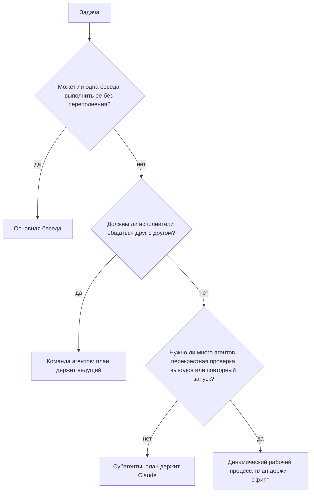

# Выберите паттерн оркестрации

<sub>**Продвинутый** · Урок 2 из 7 · около 20 минут · Требуется: [Параллельные сессии с worktrees](01-parallel-sessions.md) · Проверено с Claude Code v2.1.292 (stable) 2026-10-15</sub>

## Цель

К концу этого урока вы сможете выбирать между основной беседой, субагентами, динамическим рабочим процессом и командой агентов в зависимости от потребностей задачи и затрат, а также запускать задачу как параллельных субагентов.

## Вам понадобится

- Ваш репозиторий из [урока 1](01-parallel-sessions.md), содержащий как минимум три папки верхнего уровня с файлами, и ваша копия шаблона практики с Node.js LTS: проверка выполняется из копии. Настройте папку `.practice/` репозитория, как описано в [уроке 1 для начинающих](../beginner/01-install-and-look-around.md#you-need), если ещё не сделали этого.
- macOS, Linux или WSL 2, а также `jq`: журнал делегирования в разделе «Ваша очередь» — это команда оболочки, использующая его.
- Использование: умеренное. Каждый субагент работает в собственном контекстном окне и отправляет собственные запросы, которые учитываются в тех же лимитах использования, что и ваша основная беседа ([Создание пользовательских субагентов](https://code.claude.com/docs/en/sub-agents)). Для облегчённого запуска используйте две папки в рабочем примере и два файла в задании 1.

## Идея

Субагенты, динамический рабочий процесс и команда агентов — все они разделяют задачу между исполнителями; разница в том, кто держит план ([Когда использовать рабочий процесс](https://code.claude.com/docs/en/workflows#when-to-use-a-workflow)). С субагентами Claude решает пошагово, и каждый результат возвращается в вашу беседу. Динамический рабочий процесс — это скрипт, который пишет Claude: он содержит цикл и промежуточные результаты, поэтому может запускать множество агентов, перекрёстно проверять их выводы и повторять запуск тем же способом. В команде агентов ведущий контролирует товарищей по команде, которые напрямую обмениваются сообщениями ([Выбор подхода](https://code.claude.com/docs/en/agents#choose-an-approach)).

Любой паттерн, выходящий за рамки одной беседы, увеличивает использование: каждый субагент и каждый агент, порождаемый рабочим процессом, отправляет собственные запросы ([Почему использование растёт](https://code.claude.com/docs/en/costs#why-usage-climbs-in-a-long-session)), а команды агентов «используют значительно больше токенов, чем одна сессия» ([Когда использовать команды агентов](https://code.claude.com/docs/en/agent-teams#when-to-use-agent-teams)). Поэтому выбирайте самый дешёвый паттерн, который требуется задаче: задавайте эти вопросы по порядку и остановитесь на первом ответе, который решает вопрос.



> [!NOTE]
> «Команды агентов экспериментальны и по умолчанию отключены». ([Оркестрация команд сессий Claude Code](https://code.claude.com/docs/en/agent-teams)) В этом уроке они упоминаются как один из вариантов и не запускаются; это делает электив [Команды агентов](electives/agent-teams.md).

## Рабочий пример

1. Выберите три папки верхнего уровня в вашем репозитории, например `src`, `test` и `docs`, и запустите `claude`.
2. Задайте вопросы из схемы для одной задачи: краткое описание каждой папки для новичка. Одна беседа заполнится чтением файлов, которые больше не понадобятся, поэтому не основная беседа ([Выбор между субагентами и основной беседой](https://code.claude.com/docs/en/sub-agents#choose-between-subagents-and-main-conversation)). Резюме не должны общаться друг с другом, поэтому не команда. Это три задачи, выполняемые один раз, поэтому субагенты.
3. Запросите их, используя свои имена папок, как в примере параллельного исследования из документации ([Запуск параллельного исследования](https://code.claude.com/docs/en/sub-agents#run-parallel-research)):

   ```text
   Исследуйте папки src, test и docs параллельно с помощью отдельных субагентов и дайте мне по два предложения о каждой.
   ```

   По умолчанию интерактивная сессия запускает субагентов в фоновом режиме, поэтому ваша строка ввода остаётся свободной ([Запуск субагентов на переднем или заднем плане](https://code.claude.com/docs/en/sub-agents#run-subagents-in-foreground-or-background)). Панель под строкой ввода показывает строку для каждого из них во время работы.
4. Пока они работают, выполните `/tasks`. Она перечисляет каждого субагента с его состоянием и моделью, на которой он работает; нажмите Enter на строке, чтобы открыть его транскрипт ([Проверка выполняющейся работы](https://code.claude.com/docs/en/agents#check-on-running-work), [Выбор модели](https://code.claude.com/docs/en/sub-agents#choose-a-model)). Claude может запустить [встроенных](https://code.claude.com/docs/en/sub-agents#built-in-subagents) субагентов `Explore` или `general-purpose` или форки вашей беседы, поэтому ваши строки будут отличаться. Когда один успешно завершается, его строка исчезает с панели, а в нижнем колонтитуле ненадолго появляется `/tasks to see subagents`; строка неудавшегося остаётся на мгновение.
5. Когда резюме появятся, выполните `/usage`. На плане Pro, Max, Team или Enterprise разбивка использования относит ваше недавнее использование к навыкам, субагентам, плагинам и MCP-серверам и отмечает поведение, такое как длинный контекст, которое составляет заметную долю ([Разбивка использования по плану](https://code.claude.com/docs/en/costs#plan-usage-breakdown)). Блок Session, предназначенный для пользователей API, например вошедших с учётной записью Console, показывает оценочную стоимость этой сессии ([Использование команды `/usage`](https://code.claude.com/docs/en/costs#using-the-%2Fusage-command)). Оба значения являются оценками.
6. Назовите, что изменило бы ответ. То же резюме для каждой папки, перекрёстно проверенное и повторно запускаемое перед каждым релизом, было бы рабочим процессом — паттерном следующего урока. Рецензенты, которые должны спорить о первопричине между собой, были бы командой агентов.

## Ваша очередь

**Краткое описание:** вот четыре задачи для вашего репозитория. Выберите паттерн для каждой в зависимости от потребностей и затрат, запишите свои выборы, затем выполните ту, которая требует субагентов.

1. Проверьте три самых больших исходных файла на ошибки, которые перехватываются и игнорируются. Чтение файлов в вашей беседе перегрузило бы её, а вам нужны только выводы: один рецензент на файл, один раз, и один короткий список обратно.
2. Выполните ту же проверку для каждого исходного файла, проверьте каждый вывод по коду перед отчётом и повторяйте её перед каждым релизом.
3. Исправьте опечатку в одном сообщении об ошибке.
4. Три исследователя проверяют разные теории для нестабильного теста, обмениваются сообщениями во время работы, чтобы оспаривать выводы друг друга, и продолжают, пока не согласятся о причине.

**Критерии приёмки:**

- `.practice/a-2-choices.md` содержит по одной строке на задачу, `<номер задачи>: <паттерн> потому что <причина>`, и каждый паттерн — это `main conversation`, `subagents`, `workflow` или `agent team`.
- `.practice/a-2-hook.json` содержит этот [`SubagentStart` hook](https://code.claude.com/docs/en/hooks#subagentstart), который добавляет id и тип каждого субагента в `.practice/a-2-agents.txt` при его запуске, как журнал делегирования в [Делегирование пользовательскому субагенту](../intermediate/06-subagents.md):

  ```json
  {
    "hooks": {
      "SubagentStart": [
        { "hooks": [ { "type": "command", "command": "jq -r '[.agent_id, .agent_type] | @tsv' >> \"$CLAUDE_PROJECT_DIR/.practice/a-2-agents.txt\"" } ] }
      ]
    }
  }
  ```

- Задача 1 выполнялась как параллельные субагенты, по одному на файл, в сессии, которую вы начали с `claude --settings .practice/a-2-hook.json` ([Справочник CLI](https://code.claude.com/docs/en/cli-reference#cli-flags)).
- Задача 1 не изменила ни одного файла: рецензенты только сообщают, и `git status` не показывает изменений от них.
- Выполнялась только задача 1. Остальные три — это выборы.

## Проверка

Вы закончили, когда все следующие условия истинны:

- [ ] `.practice/a-2-choices.md` выбирает самый дешёвый паттерн, подходящий для каждой задачи.
- [ ] `.practice/a-2-agents.txt` показывает как минимум двух субагентов, запущенных для задачи 1: `cut -f1 .practice/a-2-agents.txt | sort -u` выводит два или более id.
- [ ] Самопроверка (не тестируется): для одной реальной задачи из вашего бэклога вы можете назвать её паттерн, вопрос, который решил выбор, и почему более дешёвый паттерн не подошёл бы.

Выполните `npm run check -- a-2 --dir <ваш репозиторий>` из вашей копии практики.

Если паттерн задачи неверен, задайте вопросы из схемы по порядку: подсказка проверки называет вопрос, который решает эту задачу. Если в журнале меньше двух id, начните сессию с файлом hook и запросите по одному субагенту на файл параллельно. Субагент, которого Claude возобновляет, снова записывает свой id, поэтому он считается один раз.

## Осторожно

- Запросы разрешений фонового субагента появляются в вашей основной сессии, и ответ, действующий дольше одного вызова инструмента, например разрешение на всю оставшуюся сессию, применяется ко всей сессии, включая вашу основную беседу ([Запуск субагентов на переднем или заднем плане](https://code.claude.com/docs/en/sub-agents#run-subagents-in-foreground-or-background)). Одобряйте каждый такой запрос только для одного вызова, никогда на всю оставшуюся сессию, и просите рецензентов только читать.
- Результат каждого субагента возвращается в вашу беседу, и каждый субагент тратит собственные токены во время работы, поэтому множество подробных результатов перегружает ваш контекст и увеличивает использование. Просите короткие результаты ([Запуск параллельного исследования](https://code.claude.com/docs/en/sub-agents#run-parallel-research)).
- При включённых командах агентов субагент, которого Claude называет, запускается как товарищ по команде, поэтому команда может сформироваться, когда вы запросили субагентов. Hook также записывает строку каждый раз, когда товарищ по команде, работающий внутри вашего основного терминала, обрабатывает новое сообщение ([Claude порождает товарищей по команде вместо субагентов](https://code.claude.com/docs/en/agent-teams#claude-spawns-teammates-instead-of-subagents), [SubagentStart](https://code.claude.com/docs/en/hooks#subagentstart)). Если вы включили команды, добавьте `"env": { "CLAUDE_CODE_EXPERIMENTAL_AGENT_TEAMS": "0" }` в `.practice/a-2-hook.json` как ключ верхнего уровня рядом с `"hooks"`. Файл `--settings` переопределяет ваши пользовательские, проектные и локальные настройки и экспорт оболочки, и только управляемые настройки переопределяют его ([Приоритет настроек](https://code.claude.com/docs/en/settings#settings-precedence)).

## Дальнейшие шаги

- [Запуск агентов параллельно](https://code.claude.com/docs/en/agents): официальное сравнение способов, которыми Claude Code работает над несколькими задачами одновременно, и как проверять каждую.
- [Форк текущей беседы](https://code.claude.com/docs/en/sub-agents#fork-the-current-conversation): субагент, который наследует всю вашу беседу и разделяет её кэш подсказок, для побочной задачи, требующей того же контекста.
- [Затраты токенов команды агентов](https://code.claude.com/docs/en/costs#agent-team-token-costs): что увеличивает использование команды и как его уменьшить.

---

<sub>Источники: [Запуск агентов параллельно](https://code.claude.com/docs/en/agents) · [Оркестрация субагентов в масштабе с помощью динамических рабочих процессов](https://code.claude.com/docs/en/workflows) · [Оркестрация команд сессий Claude Code](https://code.claude.com/docs/en/agent-teams) · [Создание пользовательских субагентов](https://code.claude.com/docs/en/sub-agents) · [Эффективное управление затратами](https://code.claude.com/docs/en/costs) · [Справочник по hooks](https://code.claude.com/docs/en/hooks) · [Справочник CLI](https://code.claude.com/docs/en/cli-reference) · [Файлы настроек и приоритет](https://code.claude.com/docs/en/settings)</sub>

<sub>← [Параллельные сессии с worktrees](01-parallel-sessions.md) · [Индекс продвинутых уроков](README.md) · [Запуск и сохранение динамического рабочего процесса](03-dynamic-workflows.md) → · Тема: [Субагенты и параллельная работа](../topics/subagents-and-parallel-work.md) · [Застряли на этом уроке?](https://github.com/wesammustafa/Claude-Code-Everything-You-Need-to-Know/issues/new?template=lesson-feedback.yml&lesson=a-2)</sub>
