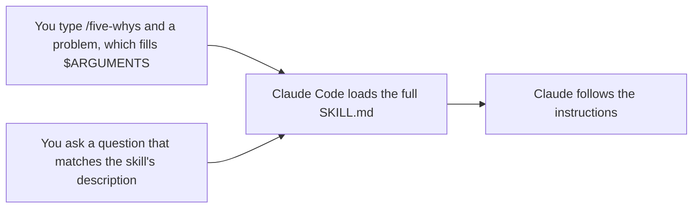

# Превратите повторяющийся рабочий процесс в skill

<sub>**Intermediate** · Урок 1 из 8 · около 20 минут · Требуется: [Intermediate index](README.md) · Проверено с Claude Code v2.1.292 (stable) 2026-10-15</sub>

## Цель

К концу этого урока вы сможете превратить повторяющийся рабочий процесс в project skill, который запускается, когда вы вводите его имя, и загружается сам, когда запрос ему соответствует.

## Вам понадобится

- Один из ваших репозиториев с тестовой командой и без незакоммиченных изменений, а также ваша копия практического шаблона с Node.js LTS: проверка выполняется из копии. Чтобы практиковаться в копии шаблона, используйте её для обоих. Настройте папку `.practice/` репозитория, как описано в [Beginner lesson 1](../beginner/01-install-and-look-around.md#you-need), если ещё не сделали.
- Использование: от лёгкого до умеренного. В разделе Your turn создаётся одна небольшая функция.

> [!NOTE]
> С этого уровня уроки написаны для macOS, Linux и WSL 2. В Windows запускайте Claude Code внутри WSL 2 ([Set up on Windows](https://code.claude.com/docs/en/setup#set-up-on-windows)): в нативной Windows нет песочницы, которую использует урок 4, а хуки в уроке 5 — это bash-скрипты.

## Идея

[Skill](https://code.claude.com/docs/en/skills) — это папка с файлом `SKILL.md`: YAML frontmatter, который говорит, для чего нужен skill, затем инструкции, которым следует Claude. Project skill находится в `.claude/skills/<name>/SKILL.md`. Закоммитьте его, и все, кто работает в репозитории, получат его.

Пока skill не запущен, в контексте Claude находится максимум его описание. Он запускается одним из двух способов, и в любом случае Claude Code затем загружает весь файл:



- `disable-model-invocation: true` в frontmatter оставляет skill только для первого способа. Используйте его для рабочих процессов с побочными эффектами, например для деплоя ([Control who invokes a skill](https://code.claude.com/docs/en/skills#control-who-invokes-a-skill)).
- `$ARGUMENTS` в теле получает всё, что вы вводите после имени skill.
- Markdown-файл в `.claude/commands/` — это старый формат, и он по-прежнему запускается как `/name`. Для новой работы предпочитайте skill.

## Рабочий пример

1. В вашем репозитории создайте папку skill и скачайте пример skill из этого руководства, [`five-whys`](../../examples/intermediate/01-first-skill/dot-claude/skills/five-whys/SKILL.md). Прочитайте его перед использованием:

   ```bash
   mkdir -p .claude/skills/five-whys
   curl -fsSL https://raw.githubusercontent.com/wesammustafa/Claude-Code-Everything-You-Need-to-Know/main/examples/intermediate/01-first-skill/dot-claude/skills/five-whys/SKILL.md -o .claude/skills/five-whys/SKILL.md
   ```

   Если не считать строк комментариев в начале frontmatter, файл содержит:

   ```markdown
   ---
   name: five-whys
   description: Finds the root cause of a bug, failure or recurring problem by asking "why" until the answer is a cause you can fix. Use when the user asks why something keeps happening, or wants the root cause rather than a quick fix.
   argument-hint: "[problem]"
   ---

   Find the root cause of this problem: $ARGUMENTS
   ```

   затем пять пронумерованных шагов и правило «Не изменяйте никакие файлы».
2. Запустите `claude` в репозитории и выполните `/skills` ([Commands](https://code.claude.com/docs/en/commands)). Список включает `five-whys`, project skill, потому что он находится в `.claude/skills/` ([Choose where skills load](https://code.claude.com/docs/en/skills#where-skills-live)).
3. Запустите skill по имени с проблемой из вашего репозитория. В практическом шаблоне:

   ```text
   /five-whys npm run linkcheck -- samples exits with code 1
   ```

   Claude воспроизводит проблему, задаёт «почему» на основе доказательств, пока не дойдёт до причины, которую команда может изменить, затем сообщает цепочку, корневую причину и два исправления. Ваша формулировка будет отличаться. Во втором терминале `git status` показывает только новые файлы в `.claude/`: skill велел Claude ничего не менять.
4. Выполните `/clear`, затем задайте вопрос, соответствующий описанию, не называя skill:

   ```text
   Why does the test suite pass even though samples/guide.md has a broken link? I want the root cause, not a quick fix.
   ```

   Прежде чем Claude ответит, в транскрипте должен появиться вызов инструмента `Skill` для `five-whys`, что означает, что Claude загрузил skill самостоятельно ([Tools reference](https://code.claude.com/docs/en/tools-reference)).

## Your turn

Завершите частичный skill, который создаёт функции по принципу test-first, затем используйте его обоими способами.

1. Скачайте частичный skill [`tdd`](../../examples/intermediate/01-first-skill/dot-claude/skills/tdd/SKILL.md):

   ```bash
   mkdir -p .claude/skills/tdd
   curl -fsSL https://raw.githubusercontent.com/wesammustafa/Claude-Code-Everything-You-Need-to-Know/main/examples/intermediate/01-first-skill/dot-claude/skills/tdd/SKILL.md -o .claude/skills/tdd/SKILL.md
   ```

   В его frontmatter есть `description: TODO` и `disable-model-invocation: true`, а шаги заканчиваются так:

   ```markdown
   2. Green: TODO
   3. Refactor: TODO
   ```

2. В вашем редакторе завершите его:
   - замените `TODO` в описании одним-двумя предложениями: что делает skill и когда Claude должен его использовать;
   - удалите строку `disable-model-invocation: true`;
   - напишите шаги Green и Refactor, сохраняя стиль шага Red.
3. Закоммитьте skill: `git add .claude/skills/tdd/SKILL.md`, затем `git commit -m "Add a tdd skill"`.
4. В сессии запустите его по имени для небольшой функции. В практическом шаблоне:

   ```text
   /tdd a slugify(heading) function in src/slug.js that turns a Markdown heading into its link anchor: lowercase, punctuation dropped, spaces turned into hyphens
   ```

   Одобряйте его правки и тестовые запуски и позвольте ему закоммитить. Затем сохраните этот коммит: `git rev-parse HEAD > .practice/i-1-commit.txt`.
5. Выполните `/clear` и попросите ещё одну небольшую функцию по принципу test-first, не называя skill, например `Add a countHeadings(markdown) function, test-first.` Следите, чтобы Claude запустил `tdd` через инструмент `Skill` самостоятельно. Как только увидите это, можете нажать `Esc`, чтобы остановить Claude ([Interactive mode](https://code.claude.com/docs/en/interactive-mode)), и `/rewind`, чтобы отменить его правки ([Checkpointing](https://code.claude.com/docs/en/checkpointing)), как в [Beginner lesson 4](../beginner/04-keep-a-session-on-track.md).

## Проверка

Вы закончили, когда все следующие условия истинны:

- [ ] Завершённый skill закоммичен без TODO: `git grep -n TODO HEAD -- .claude/skills/tdd` ничего не выводит.
- [ ] Он может запускаться как `/tdd` и загружаться самостоятельно: `git show HEAD:.claude/skills/tdd/SKILL.md` показывает описание того, что он делает и когда его использовать, и нет `disable-model-invocation: true`.
- [ ] Коммит, сохранённый в `.practice/i-1-commit.txt`, содержит тест и код, который он тестирует: `git show --stat $(cat .practice/i-1-commit.txt)` выводит оба.
- [ ] Самопроверка (не тестируется): `/tdd` запустил skill, и в очищенном разговоре Claude загрузил `tdd` самостоятельно.

Запустите `npm run check -- i-1 --dir <your repo>` из вашей практической копии или `npm run check -- i-1` в самой копии.

Если skill не закоммичен, выполните `git check-ignore -v .claude/skills/tdd/SKILL.md`: правило игнорирования, совпадающее с `.claude`, в `.gitignore`, `.git/info/exclude` или вашем глобальном файле исключений скрывает папку от `git add`, поэтому добавьте файл с помощью `git add -f`. Если второй пункт не выполняется, перепишите описание как то, что делает skill, затем «Use when» и запросы, которым он соответствует, потому что Claude решает, загружать ли skill, на основе его описания и любого текста `when_to_use` в списке skills, а не из тела skill. Если пункт с коммитом не выполняется, запустите `/tdd` снова для новой небольшой функции и позвольте ему закоммитить тест вместе с кодом.

## Осторожно

- Skill может предварительно одобрять инструменты с помощью `allowed-tools`, и Claude Code применяет разрешение project skill даже при запуске `claude -p` в папке, которой вы никогда не доверяли ([Pre-approve tools for a skill](https://code.claude.com/docs/en/skills#pre-approve-tools-for-a-skill)). Прочитайте skills в репозитории, прежде чем запускать там Claude Code.
- Если `.claude/skills/` не существовала при запуске сессии, выполните `/reload-skills`, прежде чем новый skill появится ([Edit a skill during a session](https://code.claude.com/docs/en/skills#live-change-detection)).
- После запуска skill его текст остаётся в разговоре, и Claude Code не перечитывает файл. После редактирования skill запустите его снова, чтобы Claude получил новую версию ([Skill content lifecycle](https://code.claude.com/docs/en/skills#skill-content-lifecycle)).

## Дальнейшие шаги

- [Introduction to agent skills](https://academy.claude.com/courses/introduction-to-agent-skills): курс Claude Academy по написанию и распространению skills.
- [Agent Skills](https://agentskills.io): открытый стандарт, которому следуют skills Claude Code, работает и с другими AI-инструментами.
- [Extend Claude with skills](https://code.claude.com/docs/en/skills): все поля frontmatter, аргументы, вспомогательные файлы и запуск skill в subagent.

---

<sub>Источники: [Extend Claude with skills](https://code.claude.com/docs/en/skills) · [Advanced setup](https://code.claude.com/docs/en/setup) · [Commands](https://code.claude.com/docs/en/commands) · [Tools reference](https://code.claude.com/docs/en/tools-reference) · [Interactive mode](https://code.claude.com/docs/en/interactive-mode) · [Checkpointing](https://code.claude.com/docs/en/checkpointing)</sub>

<sub>← [Intermediate index](README.md) · [Organize project memory and see what loaded](02-organize-memory.md) → · Тема: [Skills](../topics/skills.md) · [Застряли на этом уроке?](https://github.com/wesammustafa/Claude-Code-Everything-You-Need-to-Know/issues/new?template=lesson-feedback.yml&lesson=i-1)</sub>
