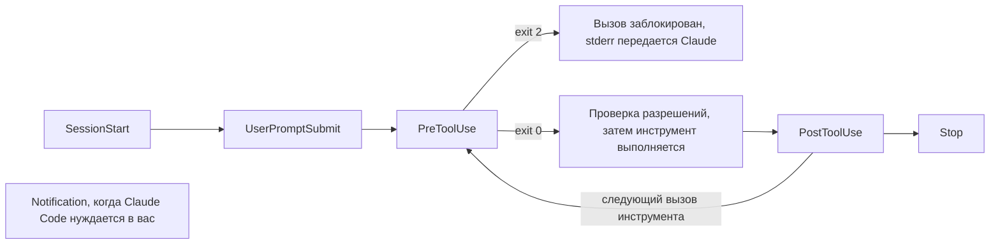

# Принудительное применение правила с помощью хука

<sub>**Intermediate** · Урок 5 из 8 · около 20 минут · Требуется: [Permissions, settings scopes and the sandbox](04-permissions-and-sandbox.md) · Проверено на Claude Code v2.1.292 (stable) 2026-10-15</sub>

## Цель

К концу этого урока вы сможете добавить хук, который принудительно применяет правило каждый раз, когда Claude редактирует файл, и продемонстрировать его срабатывание.

## Вам понадобится

- Репозиторий из [урока 4](04-permissions-and-sandbox.md) с его `.claude/settings.json` и ваша копия практического шаблона с Node.js LTS: проверка выполняется из копии.
- `jq`, который используют скрипты хуков, и `python3`, который использует `format-after-edit.sh`.
- Использование: небольшое.

## Идея

Правило в `CLAUDE.md` — это совет, который Claude может пропустить. [Хук](https://code.claude.com/docs/en/hooks-guide) — это ваша собственная команда, которую Claude Code запускает в фиксированный момент сеанса, каждый раз, независимо от решения Claude. Claude Code передает хуку JSON о событии через stdin. Хук `PreToolUse` запускается перед вызовом инструмента; если он завершается с кодом 2, вызов блокируется, а то, что он вывел в stderr, передается Claude как причина ([Справочник по хукам](https://code.claude.com/docs/en/hooks#exit-code-2-behavior-per-event), [Блокировка правок защищенных файлов](https://code.claude.com/docs/en/hooks-guide#block-edits-to-protected-files)).

Вот события, используемые в этом уроке, и их место в ходе ответа:



Матчер выбирает инструменты, за которыми следит хук: `Edit|Write` запускает его только для этих двух инструментов ([Фильтрация хуков с помощью матчеров](https://code.claude.com/docs/en/hooks-guide#filter-hooks-with-matchers)). Хуки `PreToolUse` срабатывают до проверки режима разрешений, поэтому блокировка действует в любом режиме ([Хуки и режимы разрешений](https://code.claude.com/docs/en/hooks-guide#hooks-and-permission-modes)).

## Практический пример

1. В вашем репозитории скачайте два [примера хуков](../../examples/intermediate/05-hooks/README.md) из этого руководства и сделайте их исполняемыми. Прочитайте их перед использованием:

   ```bash
   mkdir -p .claude/hooks
   for f in protect-files format-after-edit; do
     curl -fsSL "https://raw.githubusercontent.com/wesammustafa/Claude-Code-Everything-You-Need-to-Know/main/examples/intermediate/05-hooks/dot-claude/hooks/$f.sh" -o ".claude/hooks/$f.sh"
   done
   chmod +x .claude/hooks/*.sh
   ```

   `protect-files.sh` — это скрипт из руководства по хукам для блокировки правок `.env`, `package-lock.json` и `.git/`. `format-after-edit.sh` удаляет конечные пробелы из исходного файла после редактирования Claude.
2. Зарегистрируйте их в `.claude/settings.json` рядом с блоком `permissions` из урока 4:

   ```json
   "hooks": {
     "PreToolUse": [
       { "matcher": "Edit|Write", "hooks": [ { "type": "command", "command": "${CLAUDE_PROJECT_DIR}/.claude/hooks/protect-files.sh", "args": [] } ] }
     ],
     "PostToolUse": [
       { "matcher": "Edit|Write", "hooks": [ { "type": "command", "command": "${CLAUDE_PROJECT_DIR}/.claude/hooks/format-after-edit.sh", "args": [] } ] }
     ]
   }
   ```

   С `"args": []` Claude Code запускает скрипт напрямую, без оболочки, поэтому путь не требует кавычек ([Exec form и shell form](https://code.claude.com/docs/en/hooks#exec-form-and-shell-form)).
3. Проверьте хук без Claude, передав через pipe JSON, который отправил бы вызов Edit. Edit и Write всегда отправляют абсолютный путь ([Вход PreToolUse](https://code.claude.com/docs/en/hooks#pretooluse-input)), поэтому соберите его из `$PWD`:

   ```bash
   echo "{\"tool_input\":{\"file_path\":\"$PWD/package-lock.json\"}}" | .claude/hooks/protect-files.sh; echo "exit $?"
   ```

   Он выводит строку `Blocked:` и `exit 2`.
4. Запустите `claude` и выполните `/hooks`: ваши хуки появятся в разделах `PreToolUse` и `PostToolUse` ([Отладка конфигурации](https://code.claude.com/docs/en/debug-your-config#check-hooks)).
5. Попросите выполнить правку, которую защищает хук. В практическом шаблоне существует `package-lock.json`; в вашем репозитории назовите защищенный файл, который в нем есть:

   ```text
   Используйте ваш инструмент Edit, а не команду оболочки, чтобы изменить версию верхнего уровня в package-lock.json на 1.0.1.
   ```

   Правка блокируется: Claude Code передает сообщение `Blocked:` вашего скрипта Claude как обратную связь ([Вывод кода выхода](https://code.claude.com/docs/en/hooks#exit-code-output)). Здесь явно попросите использовать инструмент Edit: Claude также может редактировать файл через команду оболочки, которую хук `Edit|Write` не видит.

## Ваша очередь

Скрипт руководства сопоставляет подстроки. `*".env"*` также блокирует `.env.example`, который команды коммитят намеренно, и файл вроде `src/config.envelope.ts`; и ничто не блокирует папку `secrets/`. Замените `.claude/hooks/protect-files.sh` этим скелетом, который сохраняет блокировки `package-lock.json` и `.git/` из руководства, и завершите его:

```bash
#!/bin/bash
INPUT=$(cat)
FILE_PATH=$(echo "$INPUT" | jq -r '.tool_input.file_path // empty')
FILE_PATH="${FILE_PATH//\\//}"
NAME=$(basename "$FILE_PATH")

case "/$FILE_PATH" in
  */package-lock.json | */.git/*)
    echo "Blocked: $FILE_PATH is protected" >&2
    exit 2
    ;;
esac

# TODO: блокировать файл с именем .env или .env. с чем угодно, кроме example
# TODO: блокировать любой файл внутри папки secrets/

exit 0
```

1. Каждый блок выводит причину `Blocked:` в stderr и завершается с кодом 2; все остальное завершается с кодом 0.
2. Запустите тестовую таблицу проверки, пока каждая строка не даст ожидаемый код выхода.
3. В сеансе попросите Claude использовать его инструмент Write для создания `secrets/test.key`. Ваш хук заблокирует это.
4. Закоммитьте скрипт и `.claude/settings.json`. Сохраните скрипт исполняемым: `git ls-files -s .claude/hooks/protect-files.sh` начинается с `100755`.

## Проверка

Вы закончили, когда все следующие условия истинны:

- [ ] Каждый путь дает ожидаемый код выхода: 2 для `.env`, `config/.env.local`, `secrets/api.key`, `package-lock.json` и `.git/config`; 0 для `.env.example`, `src/config.envelope.ts` и `src/app.js`. Запустите это из корня вашего репозитория:

  ```bash
  for p in .env config/.env.local .env.example secrets/api.key src/config.envelope.ts src/app.js package-lock.json .git/config; do
    printf '%s ' "$p"; echo "{\"tool_input\":{\"file_path\":\"$PWD/$p\"}}" | .claude/hooks/protect-files.sh 2>/dev/null; echo $?
  done
  ```

- [ ] Скрипт закоммичен и исполняем, а закоммиченный `.claude/settings.json` запускает его как хук `PreToolUse` для `Edit|Write`: `git show HEAD:.claude/settings.json | jq .hooks.PreToolUse` показывает его.
- [ ] Самопроверка (не тестируется): попытка Claude создать `secrets/test.key` была заблокирована вашим сообщением `Blocked:`.

Запустите `npm run check -- i-5 --dir <your repo>` из вашей практической копии или `npm run check -- i-5` в самой копии.

Если строка неверна, проверьте этот путь отдельно и выведите имя, которое видит скрипт: `basename` от `.env.local` — это `.env.local`, поэтому шаблон `case` `.env.*` соответствует ему. Проверка запускает закоммиченный скрипт, поэтому коммитьте каждое исправление перед запуском. Если второй пункт не проходит по режиму файла, выполните `chmod +x .claude/hooks/protect-files.sh`, затем `git add` его и закоммитьте снова.

## Осторожно

- Хуки выполняются с правами вашего пользователя: в интерактивном сеансе после того, как вы доверили папку, и в запуске `claude -p` без запроса ([Доверие рабочей области](https://code.claude.com/docs/en/hooks#workspace-trust)). Прочитайте хуки репозитория, прежде чем доверять ему или автоматизировать в нем Claude Code.
- Хук `Edit|Write` не видит команды оболочки: `echo X >> .env` проходит через Bash. Правила `Read` из урока 4 останавливают команды вроде `cat .env` от чтения этих файлов, но запись вроде `>>` проверяется по правилам `Edit`, которые урок 4 не добавляет ([Перенаправления](https://code.claude.com/docs/en/permissions#redirections)). Чтобы хук видел каждое изменение, руководство по хукам добавляет матчер `Bash|PowerShell` или хук `Stop`, который сканирует рабочее дерево ([Фильтрация хуков с помощью матчеров](https://code.claude.com/docs/en/hooks-guide#filter-hooks-with-matchers)).
- Хук Notification, такой как пример [`desktop-notify.sh`](../../examples/intermediate/05-hooks/dot-claude/hooks/desktop-notify.sh), относится к вам, а не к проекту: руководство по хукам регистрирует свои примеры уведомлений в `~/.claude/settings.json`. Сделайте то же самое, указав путь к месту, где вы храните скрипт.

## Дальнейшие шаги

- [Автоматизация действий с помощью хуков](https://code.claude.com/docs/en/hooks-guide): больше готовых хуков, включая уведомления и повторное внедрение контекста после сжатия.
- [Справочник по хукам](https://code.claude.com/docs/en/hooks): каждое событие, его вход и выход.
- [Отладка конфигурации](https://code.claude.com/docs/en/debug-your-config#check-hooks): что проверять, когда хук не срабатывает.

---

<sub>Источники: [Автоматизация действий с помощью хуков](https://code.claude.com/docs/en/hooks-guide) · [Справочник по хукам](https://code.claude.com/docs/en/hooks) · [Настройка разрешений](https://code.claude.com/docs/en/permissions) · [Отладка конфигурации](https://code.claude.com/docs/en/debug-your-config)</sub>

<sub>← [Permissions, settings scopes and the sandbox](04-permissions-and-sandbox.md) · [Intermediate index](README.md) · [Delegate to a custom subagent](06-subagents.md) → · Тема: [Hooks](../topics/hooks.md) · [Застряли на этом уроке?](https://github.com/wesammustafa/Claude-Code-Everything-You-Need-to-Know/issues/new?template=lesson-feedback.yml&lesson=i-5)</sub>
