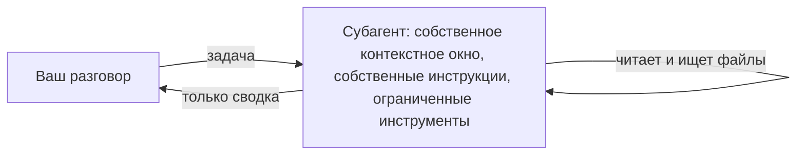

# Делегируйте задачу пользовательскому субагенту

<sub>**Intermediate** · Урок 6 из 8 · около 20 минут · Требуется: [Разрешения, области настроек и песочница](04-permissions-and-sandbox.md) · Проверено с Claude Code v2.1.292 (stable) 2026-10-15</sub>

## Цель

К концу этого урока вы сможете написать субагента, у которого есть только инструменты, необходимые для его задачи, и делегировать ему работу.

## Вам понадобится

- Один из ваших собственных репозиториев и ваша копия шаблона для практики с Node.js LTS: проверка выполняется из копии. Чтобы практиковаться в копии шаблона, используйте её для обоих.
- `jq` для журнала делегирования в разделе «Ваша очередь».
- Использование: от лёгкого до умеренного. Каждое делегирование запускает второе контекстное окно.

## Идея

[Субагент](https://code.claude.com/docs/en/sub-agents) — это отдельный Claude, которому ваша сессия передаёт задачу. Он работает в собственном контекстном окне, со своими инструкциями и только теми инструментами, которые вы ему дадите, и возвращает сводку. Его чтение файлов и результаты поиска не попадают в ваш разговор:



Проектный субагент — это файл Markdown в `.claude/agents/`: frontmatter с `name` и `description` (оба обязательны), необязательный список `tools`, затем инструкции, по которым он работает. Claude читает описание, чтобы решить, когда делегировать; вы также можете назвать субагента в своём запросе.

Делегируйте задачу, полный вывод которой вам не нужен, или которая должна выполняться с ограниченными инструментами. Оставляйте её в основном разговоре, когда требуется обмен мнениями или когда это быстрое целевое изменение ([Выбор между субагентами и основным разговором](https://code.claude.com/docs/en/sub-agents#choose-between-subagents-and-main-conversation)).

## Рабочий пример

1. В вашем репозитории скачайте пример этого руководства [`code-reviewer`](../../examples/intermediate/06-subagents/dot-claude/agents/code-reviewer.md) и прочитайте его:

   ```bash
   mkdir -p .claude/agents
   curl -fsSL https://raw.githubusercontent.com/wesammustafa/Claude-Code-Everything-You-Need-to-Know/main/examples/intermediate/06-subagents/dot-claude/agents/code-reviewer.md -o .claude/agents/code-reviewer.md
   ```

   Его frontmatter ограничивает его тремя инструментами, поэтому он может читать и искать файлы, но не может их редактировать или выполнять команды:

   ```yaml
   name: code-reviewer
   tools: Read, Grep, Glob
   ```

2. Запустите `claude`. Если сессия уже была запущена, когда вы создали `.claude/agents/`, перезапустите её: Claude Code отслеживает только папки агентов, существовавшие на момент запуска сессии ([Написание файлов субагентов](https://code.claude.com/docs/en/sub-agents#write-subagent-files)).
3. Внесите небольшое изменение в исходный файл, затем спросите:

   ```text
   Use the code-reviewer agent to review my uncommitted changes.
   ```

   В транскрипте отображается строка, например `code-reviewer(Review uncommitted changes)`, пока он работает. Ревьюер не может выполнить `git diff`, поэтому он начинает с сообщения задачи, которое ваша сессия пишет для него, и снимка статуса git ([Что загружается при запуске](https://code.claude.com/docs/en/sub-agents#what-loads-at-startup)); затем вы получаете его выводы в виде сводки, сгруппированной по серьёзности. Ваша формулировка будет отличаться.

## Ваша очередь

Завершите субагента только для чтения, который находит код, не вызываемый ни одним тестом, затем делегируйте ему.

1. Сохраните это как `.claude/agents/test-gaps.md` и замените оба `TODO`. Дайте ему только инструменты только для чтения:

   ```markdown
   ---
   name: test-gaps
   description: TODO
   tools: TODO
   ---

   You find code that no test exercises. You never change files.

   1. List the functions each source file exports.
   2. For each one, search the test files for a call to it.
   3. Report the functions that no test calls, grouped by file, with one line on what a test for each should check. If every function has a test, say so.
   ```

2. Зафиксируйте его.
3. Сохраните этот журнал делегирования в `.practice/i-6-hook.json`. Это [`SubagentStart` hook](https://code.claude.com/docs/en/hooks#subagentstart), который добавляет имя каждого субагента, запускаемого Claude, в `.practice/i-6-agents.txt` и больше ничего не регистрирует:

   ```json
   {
     "hooks": {
       "SubagentStart": [
         { "hooks": [ { "type": "command", "command": "jq -r '.agent_type' >> \"$CLAUDE_PROJECT_DIR/.practice/i-6-agents.txt\"" } ] }
       ]
     }
   }
   ```

4. Запустите `claude --settings .practice/i-6-hook.json` и спросите `Use the test-gaps agent to list the functions no test calls.`

## Проверка

Вы закончили, когда все следующие пункты верны:

- [ ] У зафиксированного субагента есть имя и описание того, когда его использовать: `git show HEAD:.claude/agents/test-gaps.md | head -5`.
- [ ] Его инструменты только для чтения: строка `tools` называет такие инструменты, как `Read`, `Grep` и `Glob`, и не содержит инструментов, которые редактируют файлы или выполняют команды, таких как `Edit`, `Write` или `Bash`.
- [ ] Claude делегировал ему: `grep -x test-gaps .practice/i-6-agents.txt` выводит `test-gaps`.
- [ ] Самопроверка (не тестируется): чтение файлов субагентом не попало в ваш разговор, и вернулась только его сводка.

Запустите `npm run check -- i-6 --dir <your repo>` из вашей копии для практики или `npm run check -- i-6` в самой копии.

Если первый пункт не выполняется, проверьте frontmatter: Claude Code пропускает файл агента без `name`, а также файл с `name`, но без `description`. Если не выполняется пункт об инструментах, удалите каждый инструмент, который может изменять файлы или выполнять команды; без строки `tools` субагент получает все инструменты. Если в журнале нет строки `test-gaps`, запустите сессию с файлом hook и назовите субагента в своём запросе.

## Осторожно

- Субагент, в списке которого есть `Bash`, всё равно может изменять файлы через команды оболочки, такие как правка `sed` или [`> file` перенаправление](https://code.claude.com/docs/en/permissions#redirections), даже без `Edit` или `Write`. Не включайте `Bash` и позвольте вашей сессии передать ему то, что показала бы команда.
- В macOS, Linux и WSL, где Glob и Grep по умолчанию отсутствуют, субагент, чей список `tools` называет `Glob` или `Grep` и не включает `Bash`, получает те, которые он называет ([Поведение инструмента Glob](https://code.claude.com/docs/en/tools-reference#glob-tool-behavior)).
- Пользовательский субагент читает ваш `CLAUDE.md`, как и основной разговор, но встроенные субагенты Explore и Plan пропускают его: повторите правило в своём запросе, когда Claude передаёт им работу ([Проверка распространённых причин](https://code.claude.com/docs/en/debug-your-config#check-common-causes)).

## Дальнейшие шаги

- [Введение в субагентов](https://academy.claude.com/courses/introduction-to-subagents): курс Claude Academy по проектированию и использованию субагентов.
- [Как и когда использовать субагентов в Claude Code](https://claude.com/blog/subagents-in-claude-code): Anthropic о том, когда делегировать, а когда оставаться в основной сессии.
- [Создание пользовательских субагентов](https://code.claude.com/docs/en/sub-agents): все поля frontmatter, фоновые субагенты и возобновление работы.

---

<sub>Источники: [Создание пользовательских субагентов](https://code.claude.com/docs/en/sub-agents) · [Справочник по hooks](https://code.claude.com/docs/en/hooks) · [Справочник по инструментам](https://code.claude.com/docs/en/tools-reference) · [Настройка разрешений](https://code.claude.com/docs/en/permissions) · [Отладка конфигурации](https://code.claude.com/docs/en/debug-your-config)</sub>

<sub>← [Принудительное применение правила с помощью hook](05-hooks.md) · [Индекс Intermediate](README.md) · [Подключение инструмента с помощью MCP](07-mcp.md) → · Тема: [Субагенты и параллельная работа](../topics/subagents-and-parallel-work.md) · [Застряли на этом уроке?](https://github.com/wesammustafa/Claude-Code-Everything-You-Need-to-Know/issues/new?template=lesson-feedback.yml&lesson=i-6)</sub>
