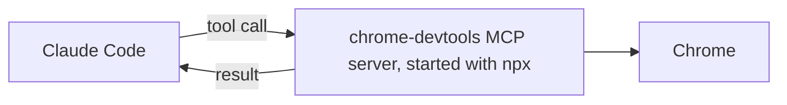

# Подключите инструмент с помощью MCP

<sub>**Intermediate** · Урок 7 из 8 · около 20 минут · Требуется: [Permissions, settings scopes and the sandbox](04-permissions-and-sandbox.md) · Проверено на Claude Code v2.1.292 (stable) 2026-10-15</sub>

## Цель

К концу этого урока вы сможете подключить MCP-сервер для себя, а затем поделиться им со всеми в проекте на уровне project scope, закрепив за одной версией.

## Вам понадобится

- Один из ваших собственных репозиториев и ваша копия практического шаблона с Node.js LTS: проверка выполняется из копии. Чтобы практиковаться в копии шаблона, используйте её для обоих. Настройте папку `.practice/` репозитория, как описано в [Beginner lesson 1](../beginner/01-install-and-look-around.md#you-need), если ещё не сделали этого.
- Chrome и npm, который поставляется с Node.js: сервер запускается через `npx` ([upstream https://github.com/ChromeDevTools/chrome-devtools-mcp/blob/chrome-devtools-mcp-v1.10.1/README.md#requirements
- Использование: небольшое.

## Идея

[MCP](https://code.claude.com/docs/en/mcp) (Model Context Protocol) позволяет Claude Code использовать инструменты, предоставляемые другой программой: MCP-сервером. Сервер этого урока — [Chrome DevTools MCP](https://github.com/ChromeDevTools/chrome-devtools-mcp) (Vendor: Google), который работает на вашей машине и даёт Claude инструменты для открытия страниц в Chrome, чтения консоли и создания скриншотов:



Где вы добавляете сервер, определяет, кто его получит ([MCP installation scopes](https://code.claude.com/docs/en/mcp#mcp-installation-scopes)):

| Scope | Кто получает | Хранится в |
|---|---|---|
| Local, по умолчанию | Вы, в этом проекте | `~/.claude.json` |
| Project | Все, кто работает в проекте | `.mcp.json` в корне проекта, закоммичен |
| User | Вы, в каждом проекте | `~/.claude.json` |

В интерактивной сессии Claude Code просит вас одобрить серверы проекта перед их использованием.

> [!WARNING]
> Данные покидают вашу машину. По умолчанию Chrome DevTools MCP отправляет статистику использования в Google, может отправлять URL-адреса трассировок производительности в CrUX API Google и проверяет npm на наличие обновлений ([upstream https://github.com/ChromeDevTools/chrome-devtools-mcp/blob/chrome-devtools-mcp-v1.10.1/README.md В этом уроке он всегда запускается с отключёнными всеми тремя. Страницы, которые открывает Claude, по-прежнему загружаются из интернета, и сервер показывает Claude всё, что есть в этом браузере.

## Рабочий пример

1. Сохраните страницу для просмотра в вашем репозитории:

   ```bash
   cat > .practice/demo.html <<'EOF'
   <!doctype html>
   <title>Linkcheck demo</title>
   <h1>Linkcheck demo</h1>
   <script>console.warn('demo warning from the page');</script>
   EOF
   ```

2. Добавьте сервер на уровне local scope, для себя. Версия закреплена, `--isolated` даёт браузеру временный профиль, а два других флага и переменная отключают потоки данных https://github.com/ChromeDevTools/chrome-devtools-mcp/blob/chrome-devtools-mcp-v1.10.1/docs/configuration.md Всё после `--` — это собственная команда сервера:

   ```bash
   claude mcp add --env CHROME_DEVTOOLS_MCP_NO_UPDATE_CHECKS=1 --transport stdio chrome-devtools -- npx -y chrome-devtools-mcp@1.10.1 --isolated --no-usage-statistics --no-performance-crux
   ```

3. Выполните `claude mcp get chrome-devtools`. Он показывает, в каком scope находится сервер, здесь local, и статус сервера ([Find your configuration on disk](https://code.claude.com/docs/en/mcp-quickstart#find-your-configuration-on-disk)).
4. Запустите `claude` и выполните `/mcp`: `chrome-devtools` указан со своими инструментами. Затем спросите:

   ```text
   Use the chrome-devtools tools to open .practice/demo.html as a file: URL, and tell me its title and console messages.
   ```

   Откроется окно Chrome, и Claude сообщит заголовок `Linkcheck demo` и предупреждение в консоли. В режиме Manual Claude Code запрашивает разрешение при первом использовании каждого инструмента Claude ([Configure permissions](https://code.claude.com/docs/en/permissions#permission-modes)).

## Ваша очередь

Поделитесь сервером со своей командой на уровне project scope.

1. Удалите свою локальную копию, которая иначе будет иметь приоритет над сервером проекта с тем же именем ([Scope hierarchy and precedence](https://code.claude.com/docs/en/mcp#scope-hierarchy-and-precedence)): `claude mcp remove chrome-devtools -s local`.
2. Сохраните этот частичный файл как `.mcp.json` в корне репозитория и замените каждый `TODO` значениями из команды рабочего примера:

   ```json
   {
     "mcpServers": {
       "chrome-devtools": {
         "type": "stdio",
         "command": "npx",
         "args": ["-y", "TODO: the package at an exact version", "--isolated", "TODO: no usage statistics", "TODO: no CrUX lookups"],
         "env": { "TODO: the variable that turns off update checks": "1" }
       }
     }
   }
   ```

3. Закоммитьте `.mcp.json`.
4. Запустите `claude`. Когда он спросит о новом MCP-сервере, найденном в этом проекте, выберите использовать его. `/mcp` теперь показывает его как подключённый ([Edit .mcp.json directly](https://code.claude.com/docs/en/mcp-quickstart#edit-mcp-json-directly)).
5. Попросите Claude использовать инструменты chrome-devtools, чтобы открыть `.practice/demo.html` и сохранить скриншот в `.practice/i-7-page.png`.

## Проверка

Вы закончили, когда все эти пункты верны:

- [ ] Закоммиченный `.mcp.json` закрепляет пакет за точной версией и отключает статистику использования, запросы CrUX и проверки обновлений: `git show HEAD:.mcp.json | jq '.mcpServers["chrome-devtools"]'` показывает их.
- [ ] Сервер сохранил скриншот: `file .practice/i-7-page.png` сообщает данные изображения PNG.
- [ ] Самопроверка (не тестируется): после того как вы одобрили его, `/mcp` показал `chrome-devtools` как подключённый.

Запустите `npm run check -- i-7 --dir <your repo>` из вашей практической копии или `npm run check -- i-7` в самой копии.

Если первый пункт не выполнен, сравните каждый аргумент с командой рабочего примера: `@latest` не закреплён. Если нет скриншота, выполните `/mcp`, чтобы увидеть, подключился ли сервер. Если вы пропустили запрос на одобрение, одобрите сервер там; если вы отклонили его, выполните `claude mcp reset-project-choices` и снова запустите `claude` ([Project scope](https://code.claude.com/docs/en/mcp#project-scope)).

## Осторожно

- Запуск `claude -p` загружает серверы проекта без запроса ([Project scope](https://code.claude.com/docs/en/mcp#project-scope)). Прочитайте `.mcp.json` репозитория, прежде чем скриптовать Claude Code в нём.
- Чтобы снова получить запрос о серверах проекта, выполните `claude mcp reset-project-choices`.

Стороннее: он может запускать код на вашей машине или давать Claude новые инструменты. Просмотрите его перед установкой; это руководство не проводит аудит.

Списки проверены по панели листинга 2026-10-06.

## Дальнейшие шаги

- [Connect to MCP servers](https://code.claude.com/docs/en/mcp-quickstart): добавление удалённых серверов, вход в них и другие способы добавления.
- [The MCP Registry](https://registry.modelcontextprotocol.io): список публичных серверов проекта MCP, помеченных как "preview" ([About](https://modelcontextprotocol.io/registry/about)).
- [What is the Model Context Protocol (MCP)?](https://modelcontextprotocol.io/docs/getting-started/intro): сам протокол.

---

<sub>Источники: [Connect Claude Code to tools via MCP](https://code.claude.com/docs/en/mcp) · [Connect to MCP servers](https://code.claude.com/docs/en/mcp-quickstart) · [Configure permissions](https://code.claude.com/docs/en/permissions) · [Chrome DevTools MCP README](https://github.com/ChromeDevTools/chrome-devtools-mcp/blob/chrome-devtools-mcp-v1.10.1/README.md) · [Chrome DevTools MCP configuration](https://github.com/ChromeDevTools/chrome-devtools-mcp/blob/chrome-devtools-mcp-v1.10.1/docs/configuration.md) · [The MCP Registry](https://modelcontextprotocol.io/registry/about)</sub>

<sub>← [Delegate to a custom subagent](06-subagents.md) · [Intermediate index](README.md) · [Install and manage plugins](08-plugins.md) → · Тема: [MCP](../topics/mcp.md) · [Застряли на этом уроке?](https://github.com/wesammustafa/Claude-Code-Everything-You-Need-to-Know/issues/new?template=lesson-feedback.yml&lesson=i-7)</sub>
